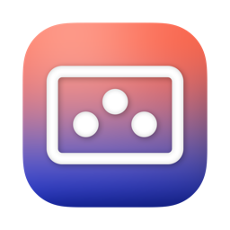
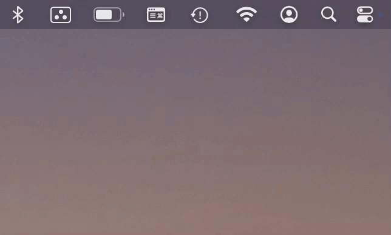

# TripleClick

A very lightweight macOS menu-bar app: **click the trackpad with three fingers to middle-click.**

Open a browser link in a new tab, close a tab, and anything else an app does on a middle click.

To middle-drag: click with three fingers, lift two, and drag with one.

This input method preserves compatibility with standard 3-finger gestures for Mission Control, App Exposé and switching desktops.

The menu-bar icon lets you toggle both mouse input features, and auto-launch.



## Why TripleClick

- **Tiny:** about 220 lines of Swift, and it uses about 12 MB of memory and no CPU when idle.
- **Offline:** unlike some similar tools, it has no crash reporter, auto-updater or analytics. It never connects to the internet.
- **Keeps your gestures:** unlike tools that turn moving three fingers into a middle-drag, TripleClick's drag starts with a click. Three-finger swipes stay with macOS for Mission Control, App Exposé and switching desktops.
- **Free and open source** under the MIT license. Works on macOS 13 and later.


## Install

```sh
curl -fsSL https://raw.githubusercontent.com/wilu222/tripleclick/main/install.sh | bash
```

(Read [install.sh](install.sh) first if you like. It downloads the latest release zip into `/Applications` and opens it.)

Or download `TripleClick.zip` from [Releases](https://github.com/wilu222/tripleclick/releases).
Because the app isn't notarized, macOS will block the first launch. Allow it under
System Settings → Privacy & Security → **Open Anyway**, or run
`xattr -dr com.apple.quarantine /Applications/TripleClick.app`.

Or build from source (needs the Xcode command line tools):

```sh
git clone https://github.com/wilu222/tripleclick && cd tripleclick && make install
```

On first launch, grant **Accessibility** access in System Settings → Privacy & Security. The app needs it to change clicks.

## Uninstall

Quit the app, delete `/Applications/TripleClick.app`, and remove it from the Accessibility list.

## License

[MIT](LICENSE)
